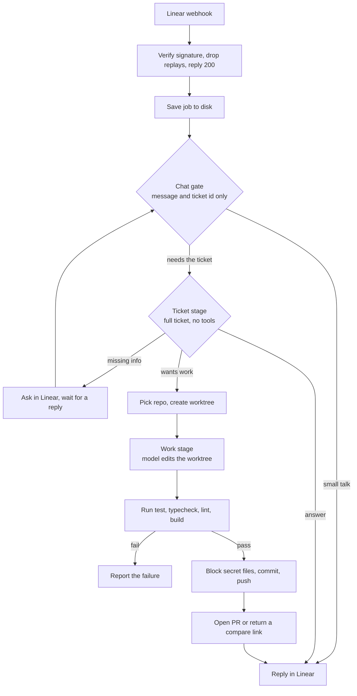

# Ghost

Ghost is a coding agent you talk to from Linear. Mention it on a ticket and it reads the request, decides whether code needs to change, makes the change in an isolated git worktree, runs the repo's checks, and opens a pull request. If it needs more information, it asks in the ticket and picks up again when you reply.

It's a small Node.js and TypeScript service with one runtime dependency (Express): about 5,100 lines of source and 208 tests. It ran on a single VPS against four of my repos and is no longer deployed. The code is here to read.

## How a request flows



Each stage costs more than the one before it, so the model only gets more context and more steps when the request calls for them. The chat gate gets 5 steps and never sees the ticket body. The ticket stage gets 15 steps and no tools. The work stage gets 50 steps inside the worktree. There are no word lists or hardcoded intents: the model decides, and any output Ghost can't parse falls back to plain chat.

## Design decisions

The model does the thinking and Ghost does everything that has to be reliable. Ghost owns the worktree, the checks, the commit, the push, the pull request and the status updates in Linear, so a model that says the tests passed can't get broken code published.

Webhooks return 200 straight away and the work runs in the background. Every job is a JSON file written atomically, so a restart or a duplicate delivery never runs the same work twice. Delivery IDs are kept on disk for 24 hours to stop replays.

Your checkout is never touched. Each session gets its own worktree from a fresh `origin/main`, so sessions on the same repo run at once without colliding. Ghost never force-pushes, and it won't reuse a remote branch that belongs to another job. Concurrency is capped at 2 model runs by default.

Ghost never guesses a repo. It tries the Linear label, then the project map, then an alias in the title or prompt, then the session's known repo. If that's still ambiguous, it asks you.

Ghost only reports what happened. If there's no GitHub token, it pushes the branch and returns a compare link without claiming a PR exists. If the model answers in prose instead of JSON, Ghost posts the reply and marks it as degraded.

## Security

The agent runs arbitrary repo code, so its environment is built from an allowlist. `src/childEnv.ts` builds a minimal environment for git, test and build commands, with no service credentials. The model process gets that plus `MODEL_API_KEY` and nothing else. Linear, GitHub and Bitwarden secrets never reach it.

Other protections:

- Linear signatures are checked with a timing-safe HMAC, with a 60-second timestamp window
- All processes spawn from argv arrays with `shell: false`, timeouts and output caps, so ticket text never reaches a shell
- Known secret values are redacted before anything is written to logs, job files or Linear
- `.env`, `*.pem`, `*.key`, `id_rsa`, `tokens.json` and similar files are rejected before commit
- `/ops` and `/jobs` answer only on loopback

## Layout

| File | What it does |
|---|---|
| `src/index.ts` | HTTP server and webhook verification |
| `src/agentSession.ts` | Session lifecycle: created, prompted, follow-ups |
| `src/pipeline.ts` | The chat, ticket and work stages |
| `src/chat.ts` | Chat gate and conversation state |
| `src/museRunner.ts` | Runs the model CLI and parses its output defensively |
| `src/gitPipeline.ts` | Worktrees, commit, push and cleanup |
| `src/validation.ts` | Picks and runs repo checks, rejects secret files |
| `src/github.ts` | Pull requests and compare links |
| `src/repoResolver.ts` | Maps a ticket to a repo |
| `src/jobStore.ts` | Durable job state with atomic writes |
| `src/childEnv.ts` | Environment allowlists for child processes |
| `src/ops.ts` | Loopback status endpoints |

## Running it

You need Node 18 or newer, a Linear API key and webhook secret, and the Muse Code CLI for the model calls. The repo list in `src/repoResolver.ts` and the default paths in the source point at my own setup, so change those first.

```bash
npm install
npm test
npm run build

LINEAR_API_KEY=... LINEAR_WEBHOOK_SECRET=... GHOST_DATA_DIR=/tmp/ghost-data npm start
```

| Variable | Purpose |
|---|---|
| `LINEAR_API_KEY` | Linear personal API key |
| `LINEAR_WEBHOOK_SECRET` | Verifies incoming webhooks |
| `GHOST_PORT`, `GHOST_HOST` | Bind address, `127.0.0.1:8791` in production |
| `GHOST_DATA_DIR` | Jobs, worktrees and delivery records |
| `GITHUB_TOKEN` or `GH_TOKEN` | Opens PRs. Without it you get a compare link |
| `GHOST_PROJECT_MAP` | JSON map from Linear project to repo id |
| `GHOST_REPO_MAP` | JSON map from repo id to local path |
| `GHOST_MAX_CONCURRENT_MUSE` | Parallel model runs, 1 to 8, default 2 |
| `GHOST_MUSE_BIN`, `GHOST_MUSE_TIMEOUT_MS` | Model CLI path and timeout |

`scripts/deploy.sh` backs up the current release, syncs the code, builds and tests on the server, restarts, checks health, and rolls back on failure.

## Tests

`npm test` builds the project and runs the Node test runner. The suite covers the chat gate, ticket flow, repo resolution, restart and duplicate handling, branch naming, command spawning, model output parsing, secret file rejection, environment isolation and the PR fallback.
